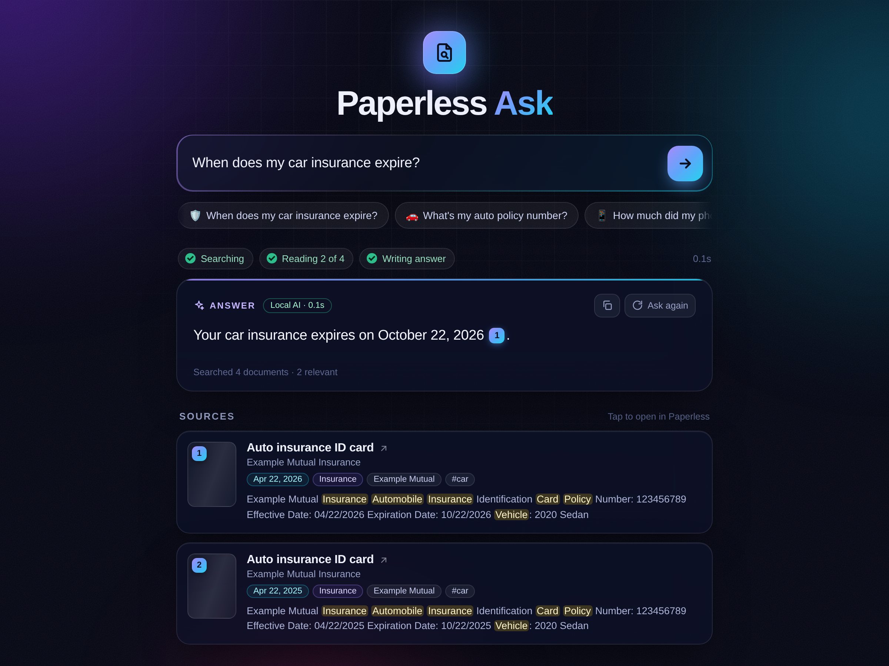

# Paperless Ask

Ask your [Paperless-ngx](https://docs.paperless-ngx.com/) library questions in plain language,
like *"When does my car insurance expire?"* or *"How much was the flooring install?"*. You get a
short answer with numbered citations that link to the documents in Paperless.

The answers come from a local [Ollama](https://ollama.com/) model, so your documents never
leave your network. It runs fine on a CPU-only home server.



## Features

- **One mobile-friendly page.** It has an ask box, example questions, an answer card with
  citation pills, and source cards. Each source card shows a thumbnail, the date, tags and the
  matching passage, and opens the document in Paperless when tapped. It saves your recent
  questions in the browser and can be added to a phone's home screen.
- **Fast sources, streamed answer.** Matching documents appear in about 0.1 s. The AI's answer
  then streams in, typically in 10–30 s with a 3B model on a CPU.
- **Honest answers.** If a key word (such as a company name) appears in no document, it says so
  instead of guessing. Every number and date in an AI answer is checked against the cited
  documents, and anything it can't find there is flagged "Check the source".
- **Works without the AI.** If Ollama is down or busy, you still get the best-matching passages
  and the key amounts and dates. Questions like "show me / find / list …" return a document
  list straight away without the model.
- **Read-only.** It only needs a Paperless API token for a view-only user.
- `http://<host>/?q=…` asks a question straight away, which is handy for phone shortcuts.
  `POST /api/ask` gives scripts a JSON API.

## How it works

```
browser ──HTTP──▶ paperless-ask (FastAPI)
                   ├─ in-memory copy of every document's OCR text, read via the Paperless API
                   │    (checks for changes every 30 s, full re-read every 5 min)
                   ├─ ranking: BM25 + synonyms/typo matching + month/year + recency boosts,
                   │    fused with Paperless's own full-text search
                   ├─ picks the best passages from the top 3 documents
                   └─ Ollama (/api/chat, streamed over Server-Sent Events) → number/date check
```

The whole library is held in memory. That suits personal and family archives (hundreds to a
few thousand documents) but not huge ones.

## Requirements

- Paperless-ngx 2.x, reachable from where this app runs.
- Ollama with an instruct model. `qwen2.5:3b-instruct` (about 2 GB RAM) is the tested default.
  `qwen2.5:1.5b-instruct` is about twice as fast but misreads totals more often. Larger models
  give better answers if you have a GPU or more cores.
- Docker, or Python 3.10+.

## Paperless setup: a read-only user

Give the app its own **view-only** account rather than your admin token:

1. In Paperless, go to **Settings → Users & Groups** and add a user, e.g. `ask-reader`, with a
   long random password nobody needs to know. Keep it *active* (inactive users' tokens are
   rejected), and don't make it staff or a superuser.
2. Grant it only **View** permissions for Document, Tag, Correspondent, Document Type, Storage
   Path, Custom Field and Note.
3. Let it see your documents. Documents with an owner are only visible to that owner and to
   users they're shared with. So:
   - **Existing documents:** select them all in the document list and use **Permissions** in
     the bulk editor to add `ask-reader` as a viewer. Choose *merge*, so nobody else loses access.
   - **New documents:** add a workflow with the trigger *Document Added* and an action that
     assigns view permission to `ask-reader`. Without it, new uploads stay invisible to the app.
4. Create an API token for the user. As an admin, open **Django admin → Auth Token → Add**, or
   sign in as the user and use **My Profile → API Auth Token**. This is your `PAPERLESS_TOKEN`.

You can check it worked: `curl -H "Authorization: Token <token>" <paperless>/api/documents/`
should list your documents, and a `PATCH` with the same token should return 403.

## Install with Docker Compose (recommended)

```bash
git clone https://github.com/3g15h1/paperless-ask.git
cd paperless-ask
cp .env.example .env          # set PAPERLESS_URL and PAPERLESS_TOKEN
docker compose up -d
docker compose exec ollama ollama pull qwen2.5:3b-instruct   # first run only
```

Then open `http://<your-server>:8000`. The compose file runs both Paperless Ask and Ollama.
**Already have Ollama?** Delete the `ollama` service from `docker-compose.yml` and set
`OLLAMA_URL` in `.env`. From inside a container, use your server's IP (or
`http://host.docker.internal:11434` on Docker Desktop), not `localhost`.

**Running in the same compose project as Paperless?** Add the `paperless-ask` service to
Paperless's compose file and use `PAPERLESS_URL=http://webserver:8000`. Set
`PAPERLESS_LINK_URL` to the address your browser uses for Paperless, so source links open.

Prebuilt images (amd64 and arm64) are published to `ghcr.io/3g15h1/paperless-ask`:

```bash
docker run -d --name paperless-ask -p 8000:8000 --env-file .env ghcr.io/3g15h1/paperless-ask:latest
```

## Install without Docker

On Debian/Ubuntu (or any systemd distro with Python 3.10+):

```bash
git clone https://github.com/3g15h1/paperless-ask.git
cd paperless-ask
sudo ./deploy/install.sh                 # creates user, venv in /opt/paperless-ask, systemd unit
sudo nano /etc/paperless-ask/env         # PAPERLESS_URL, PAPERLESS_TOKEN, OLLAMA_URL
sudo systemctl start paperless-ask
journalctl -u paperless-ask -f
```

Run `install.sh` again after `git pull` to upgrade. It never overwrites your env file.

Or just run it directly:

```bash
pip install git+https://github.com/3g15h1/paperless-ask.git
PAPERLESS_URL=http://paperless:8000 PAPERLESS_TOKEN=... paperless-ask --port 8000
```

## Configuration

Everything is set with environment variables. [`.env.example`](.env.example) lists them all
with explanations.

| Variable | Default | |
|---|---|---|
| `PAPERLESS_URL` | `http://localhost:8000` | Paperless address used by the app |
| `PAPERLESS_TOKEN` / `PAPERLESS_TOKEN_FILE` | — | API token of the read-only user (or a file containing it) |
| `PAPERLESS_LINK_URL` | `PAPERLESS_URL` | Paperless address used in links opened by your browser |
| `OLLAMA_URL` | `http://localhost:11434` | Ollama server |
| `OLLAMA_MODEL` | `qwen2.5:3b-instruct` | Model; pull it in Ollama first |
| `OLLAMA_THREADS` | Ollama's choice | Set to the cores available on CPU-limited VMs/containers (see below) |
| `ASK_PASSWORD` / `ASK_USERNAME` | none / `ask` | Turns on a login (HTTP Basic) |
| `ASK_SUGGESTIONS` | built-in examples | Example questions, `|`-separated, optional emoji prefix |
| `ASK_SYNONYMS` | — | Extra search synonyms, e.g. `electric=acmepower; internet=fastnet` |
| `HOST` / `PORT` | `0.0.0.0` / `8000` | Where to listen |

**Tips**

- **Teach it your provider names.** If your electricity company is "AcmePower", add
  `ASK_SYNONYMS=electric=acmepower`, and "electric bill" will find its statements.
- **CPU-limited LXC containers or VMs:** Ollama sizes its thread count from the *host's* cores,
  not the container's limit. On a 2-core container it can run 4+ threads and slow down by up to
  50x. Set `OLLAMA_THREADS` to the number of cores Ollama really has (on the Ollama side,
  `num_thread` does the same).
- **One model at a time.** Ollama on a small machine usually keeps one model loaded. If
  Paperless's own AI features use Ollama too, point both at the same model to avoid reloads.

## Security

- **There's no login unless you set `ASK_PASSWORD`.** Anyone who can reach the page can ask
  questions and read passages from your documents. Set a password, or keep the app on a
  trusted network or behind your reverse proxy's authentication. Use HTTPS (via a reverse
  proxy) if the password crosses an untrusted network.
- `/healthz` stays open for health checks. With a password set, it returns only status, counts
  and the version.
- Use a read-only Paperless token (see above). The app never writes to Paperless.
- Questions and timings are logged to stdout. Tokens and document text are not.

## API

| Endpoint | |
|---|---|
| `GET /` | The web UI; `/?q=...` asks right away |
| `GET /api/ask/stream?q=...` | Server-Sent Events: `sources`, `stage`, `token`…, `done` (or `llm_error`/`fatal`) |
| `POST /api/ask` `{"q": "...", "no_llm": false}` | JSON answer for scripts |
| `GET /api/stats` | Document count and model status |
| `GET /healthz` | 200 once the library is loaded, else 503 |
| `GET /thumb/<id>` | Document thumbnail, proxied from Paperless |

`scripts/smoke_test.py --url http://host:8000` asks a few questions and prints answers with
sources and timings.

## Development

```bash
python3 -m venv .venv && .venv/bin/pip install -e ".[test]"
.venv/bin/pytest -q
```

The tests run the whole app against a fake Paperless and a fake Ollama (`tests/fake_library.py`),
so they need neither.

## Limits

- Accuracy depends on OCR quality. Dense tabular forms (W-2s and other tax forms) are the
  hardest, so check the cited source for anything important.
- Answers are short (1–3 sentences) and based on the top 3 documents. It's for finding facts,
  not summarising your whole archive.
- English-oriented: stop words, dates and synonyms assume English documents and questions.

## License

[MIT](LICENSE)
